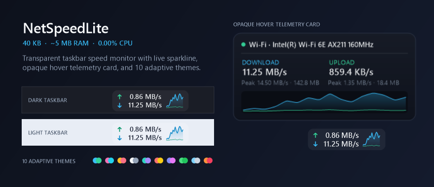

# 🚀 NetSpeedLite — Ultra-Featherlight Live Network Speed Monitor for Windows 11 & 10 Taskbar

> **A modern, zero-bloat, open-source alternative to TrafficMonitor, NetSpeedMonitor, and DU Meter.**  
> Real-time upload and download speed displayed directly on your Windows taskbar with microscopic resource usage.

<div align="center">

[-2563EB?style=for-the-badge&logo=windows&logoColor=white)](https://github.com/git-ysf/NetSpeedLite/releases/latest/download/NetSpeedLite-x64.exe)
[-059669?style=for-the-badge&logo=arm&logoColor=white)](https://github.com/git-ysf/NetSpeedLite/releases/latest/download/NetSpeedLite-AnyCpu.exe)

<br/>

[](https://github.com/git-ysf/NetSpeedLite/releases/latest)
[](https://github.com/git-ysf/NetSpeedLite/actions/workflows/ci.yml)
[](LICENSE)
[](https://microsoft.com/windows)
[](#)
[](#)
[](#)
[](#)

<br/><br/>



</div>

---

## 💡 What is NetSpeedLite?

**NetSpeedLite** is an ultra-featherlight, portable Windows taskbar utility designed to monitor real-time internet upload and download speeds. Docked smoothly next to the system tray notification chevron (`^`), NetSpeedLite delivers accurate network throughput metrics with **subpixel anti-aliasing**, **true taskbar transparency**, and **continuous visibility**.

Unlike heavy monitoring suites that consume hundreds of megabytes of RAM or throw constant update popups, NetSpeedLite operates on a **zero-bloat philosophy**: a single standalone executable of just **~40 KB**, consuming only **~5 MB of RAM** and **0.00% CPU**.

```
       Taskbar Preview (Per-Pixel Alpha Glass Pill + Live Sparkline)
┌────────────────────────────────────────────────────────────────────────┐
│  [Windows Start]   [Apps]     ↑  1.42 MB/s  ∿   ^  ENG  📶  🔊         │
│                               ↓ 24.85 MB/s  ∿                          │
└────────────────────────────────────────────────────────────────────────┘
```

---

## 🥊 Comparison with Other Windows Network Monitors

Why switch to NetSpeedLite? Here is how it compares against popular legacy and commercial network monitors:

| Feature / Metric | 🏆 **NetSpeedLite** | ⚠️ **TrafficMonitor** | ⚠️ **NetSpeedMonitor** | ⚠️ **DU Meter** | ⚠️ **XMeters** |
| :--- | :---: | :---: | :---: | :---: | :---: |
| **Windows 11 Taskbar Support** | **Native & Flawless** | Prone to dropouts | Broken (requires hacks) | DeskBand overlay | Broken on modern Win 11 |
| **Executable Size** | **~40 KB** | ~35 MB | ~3.5 MB | ~15 MB | ~25 MB |
| **RAM Footprint** | **~5.5 MB** | 30 MB – 65 MB | 15 MB – 25 MB | 25 MB – 45 MB | 20 MB – 35 MB |
| **CPU Impact** | **0.00% (microsecond deltas)** | 0.3% – 1.5% | 0.5% – 1.0% | 0.5% – 2.0% | 0.8% – 2.5% |
| **External Dependencies** | **None (Native OS)** | LibreHardwareMonitor DLLs | Old VC++ 2005 Runtimes | Proprietary drivers | .NET Framework 4.0 runtime |
| **Annoying Popups** | **Zero (100% Silent)** | Frequent update prompts | None (Abandonware) | Trial & purchase nags | Pro version upsells |
| **Maximized Window Visibility** | **Continuously Visible** | Frequently hides | N/A | Flashes | Inconsistent |
| **Pricing & License** | **100% Free (MIT)** | Free (GPL v2) | Free (Closed Source) | Paid ($29.95) | Freemium ($4.99) |

---

## 💻 Supported Devices & Download Options

NetSpeedLite runs on all modern and legacy Windows devices with zero installation required:

### 📱 Supported Device Categories
- 💻 **Laptops & Ultrabooks:** Lenovo (IdeaPad Pro, Legion, ThinkPad, Yoga), Dell (XPS, Inspiron, Latitude), HP (Spectre, Envy, Omen), ASUS (ZenBook, ROG, TUF), Acer, Samsung Galaxy Book.
- 🖥️ **Desktops & Workstations:** Custom PC builds, Intel NUCs, Mini PCs (Beelink, Minisforum), video editing and 3D rendering workstations.
- 📱 **2-in-1s & Tablets:** Microsoft Surface Pro / Surface Laptop / Surface Go, HP Pavilion x360, Dell 2-in-1s.
- 🎮 **Windows Gaming Handhelds:** ASUS ROG Ally / Ally X, Lenovo Legion Go, MSI Claw, Steam Deck (running Windows 11/10).
- ⚡ **ARM64 & Copilot+ PCs:** Qualcomm Snapdragon X Elite & Snapdragon X Plus devices (Surface Pro 11, Surface Laptop 7, Lenovo Yoga Slim 7x, Dell XPS 13 Copilot+).

---

### ⚡ Quick Install via Windows Package Manager (Winget)

```powershell
winget install git-ysf.NetSpeedLite
```

---

### 📦 Multi-Architecture Downloads

| Architecture | Target Devices | Size | Direct Download |
| :--- | :--- | :---: | :---: |
| **x64 (64-bit)** *(Recommended)* | 99% of modern Intel & AMD laptops, desktops, and handhelds | `~40 KB` | [**Download NetSpeedLite-x64.exe**](https://github.com/git-ysf/NetSpeedLite/releases/latest/download/NetSpeedLite-x64.exe) |
| **AnyCpu (Universal / ARM64)** | **ARM64 Copilot+ PCs** (Snapdragon X Elite), Surface Pro, Intel & AMD | `~40 KB` | [**Download NetSpeedLite-AnyCpu.exe**](https://github.com/git-ysf/NetSpeedLite/releases/latest/download/NetSpeedLite-AnyCpu.exe) |
| **x86 (32-bit)** | Older 32-bit PCs, lightweight Windows VMs, legacy tablets | `~40 KB` | [**Download NetSpeedLite-x86.exe**](https://github.com/git-ysf/NetSpeedLite/releases/latest/download/NetSpeedLite-x86.exe) |
| **ARM (32-bit)** | Legacy Windows ARM / Surface RT-class devices | `~40 KB` | [**Download NetSpeedLite-arm.exe**](https://github.com/git-ysf/NetSpeedLite/releases/latest/download/NetSpeedLite-arm.exe) |
| **All-in-One (.zip)** | Portable archive containing all architectures & documentation | `~95 KB` | [**Download NetSpeedLite-v1.2.0.zip**](https://github.com/git-ysf/NetSpeedLite/releases/latest/download/NetSpeedLite-v1.2.0.zip) |
| **Checksums** | SHA-256 verification hashes for all release binaries | `~450 B` | [**Download SHA256SUMS.txt**](https://github.com/git-ysf/NetSpeedLite/releases/latest/download/SHA256SUMS.txt) |

> 💡 *All builds are completely portable: single standalone `.exe` files with no installer needed. Browse all current and previous releases (`v1.0.0` – `v1.2.0`) on the [GitHub Releases Page](https://github.com/git-ysf/NetSpeedLite/releases) or see [`CHANGELOG.md`](CHANGELOG.md).*

---

## ✨ Key Features & Architectural Highlights

### 🪶 1. True Featherlight Architecture
- **Single Portable File:** No installer, no background services, no scheduled tasks, no temporary extraction folders.
- **Micro-Memory Allocation:** Operates within ~5 MB of RAM, leaving your system completely unburdened for creative software (DaVinci Resolve, Adobe Premiere Pro, Blender) or gaming.
- **0.00% CPU Consumption:** Samples network deltas once every 1,000 ms using hardware counters and remains fully asleep between ticks.

### ⏱️ 2. Hardware-Accurate Speed Sampling
- **High-Precision Timing:** Uses the CPU's invariant Time Stamp Counter (`Stopwatch.GetTimestamp()`) for nanosecond-level delta timing, avoiding standard Windows timer jitter.
- **Cached Adapter Routing:** Automatically discovers and caches your active network adapter (Wi-Fi 6E/7, Gigabit Ethernet, USB tethering). Reads statistics in **0.1 milliseconds** instead of querying the entire network stack.
- **Dynamic Throughput Formatting:** Clean, readable units from `0.00 KB/s` up to `999.99 MB/s` and `GB/s`.

### 🛡️ 3. Zero-Flicker Continuous Visibility
- **No Maximized-Window Dropouts:** Specifically engineered for Windows 11 so that opening full-screen or maximized applications (browsers, video editors, IDEs) never causes the widget to disappear.
- **Atomic Double-Buffered Painting:** Overrides the Windows background-erase message (`WM_ERASEBKGND`) to deliver smooth, flicker-free digital clock-style number updates.
- **Self-Healing Z-Order:** Anchors automatically to the left edge of `TrayNotifyWnd` and maintains top-level positioning alongside the system tray chevron.

### 🎨 4. Per-Pixel Alpha Glass, 10 Themes & Hover Telemetry Flyout
- **Borderless Transparent Glass Pill:** True 32-bit `UpdateLayeredWindow` rendering adapts automatically to Windows 11/10 Dark and Light taskbars, or switches to pure floating text (**Minimal** mode).
- **10 Adaptive Color Themes:** Choose from **Ocean**, **Cyber Neon**, **Amber Dusk**, **Monochrome**, **Aurora**, **Crimson**, **Lavender**, **Matrix**, **Nordic**, and **Sunset** via the right-click menu.
- **Opaque Hover Telemetry Card:** Hovering over the widget opens a crisp opaque flyout displaying your active network adapter, live & peak speeds, session data transferred, and a smooth 16-second dual-channel sparkline — with zero idle resource cost.
- **Bits / Bytes Toggle:** Switch seamlessly between `KB/s`/`MB/s`/`GB/s` and `Kbps`/`Mbps`/`Gbps`.
- **Modern Dark Context Menu:** Right-clicking opens a custom dark-mode menu with rounded highlights and vector checkmarks.

### 🖱️ 5. Non-Intrusive Controls
| Action | Result |
| :--- | :--- |
| **Hover** (180 ms) | Opens the opaque live telemetry flyout (adapter, peaks, session data, sparkline) |
| **Right-click** | Switch between **10 themes**, toggle **Glass Pill**, **Mini Sparkline**, **Bits (Mbps)**, or **Start with Windows** |
| **Middle-click** | Instantly resets session data totals & peak speeds |
| **Double-click** | Opens Windows Task Manager (`taskmgr.exe`) |
| **Left-click** | Click-through (`WS_EX_NOACTIVATE`) — never steals focus from your active app |

---

## ❓ Frequently Asked Questions (FAQ)

### How do I show live internet speed on the Windows 11 taskbar?
Download [NetSpeedLite-x64.exe](https://github.com/git-ysf/NetSpeedLite/releases/latest/download/NetSpeedLite-x64.exe), place it anywhere on your computer (e.g. `C:\Program Files\NetSpeedLite\`), and double-click to run it. It immediately appears on your taskbar next to your system tray icons.

### Why does my net speed monitor keep disappearing behind windows?
Legacy monitors like TrafficMonitor often mistake maximized standard windows (browsers, File Explorer, video editors) for full-screen games because maximized windows have boundary rectangles that touch or exceed screen edges. NetSpeedLite is explicitly engineered to ignore these false triggers and remains permanently and continuously visible.

### Does NetSpeedLite collect telemetry or check for updates?
No. NetSpeedLite contains **zero telemetry, zero analytics, and zero remote network requests**. It does not make any background connections to external servers. All network measurements are read locally from the Windows kernel network interface tables.

### How do I make NetSpeedLite start automatically with Windows?
Simply right-click the speed numbers on your taskbar and check **Start with Windows**. It automatically creates a lightweight user startup entry in `HKCU\Software\Microsoft\Windows\CurrentVersion\Run`.

### Does it support Snapdragon X Elite Copilot+ PCs?
Yes! Download the [NetSpeedLite-AnyCpu.exe](https://github.com/git-ysf/NetSpeedLite/releases/latest/download/NetSpeedLite-AnyCpu.exe) build, which JIT-compiles natively for ARM64 hardware with maximum execution speed and zero battery drain.

---

## 🌐 Cross-Platform Editions

NetSpeedLite now includes native, zero-bloat editions across desktop and mobile platforms under [`platforms/`](platforms):

| Platform | Artifact / Output | Highlights | Build / Source |
| :--- | :--- | :--- | :--- |
| **Windows 11 / 10** | `NetSpeedLite-x64.exe` / `AnyCpu` / `x86` | Native C# WinForms taskbar glass pill, hover telemetry card, 10 themes | [`src/`](src) (`build_all.ps1`) |
| **Android** | `NetSpeedLite-Android.apk` | Native Java foreground service, live notification speed readout (`TrafficStats`), zero external dependencies | [`platforms/android/`](platforms/android) |
| **macOS** | `NetSpeedLite-macOS.zip` | Universal (`arm64` + `x86_64`) Swift/AppKit menu bar app with popover telemetry card & sparkline | [`platforms/macos/`](platforms/macos) (`build_macos.sh`) |
| **Linux** | `netspeedlite-linux-x86_64` | Zero-dependency C99 binary reading `/proc/net/dev` with `--waybar`, `--polybar`, `--tui`, `--once`, and `--json` modes | [`platforms/linux/`](platforms/linux) (`Makefile`) |
| **iOS / iPadOS** | `NetSpeedLite-iOS-unsigned.ipa` / Xcode | Native SwiftUI + WidgetKit app & live widgets (built via XcodeGen / Xcode) | [`platforms/ios/`](platforms/ios) (`build_ios.sh`) |

---

## 🛠️ Building from Source

NetSpeedLite requires no external SDKs or Visual Studio installations. It compiles cleanly with the C# compiler built into every Windows installation:

### Quick Build (PowerShell):
```powershell
# Compile all variants (x64, x86, AnyCpu):
powershell -ExecutionPolicy Bypass -File .\build_all.ps1

# Or single quick build:
powershell -ExecutionPolicy Bypass -File .\build.ps1
```

### Quick Build (Command Prompt):
```cmd
build.bat
```

---

## 📄 License

Distributed under the **MIT License**. See [`LICENSE`](LICENSE) for details.
